<!-- HEADER -->

  <picture>
    <source media="(max-width: 600px)" srcset="https://raw.githubusercontent.com/codenamebern-design/codenamebern-design/HEAD/assets/header-mobile.svg" />
    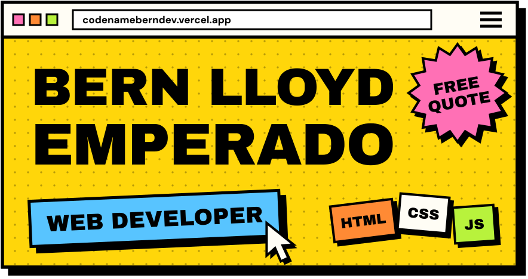
  </picture>

  <picture>
    <source media="(max-width: 600px)" srcset="https://raw.githubusercontent.com/codenamebern-design/codenamebern-design/HEAD/assets/ticker-mobile.svg" />
    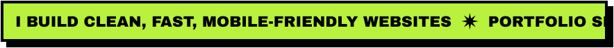
  </picture>

  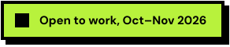
  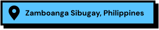
  

  <a href="mailto:codenamebern@gmail.com">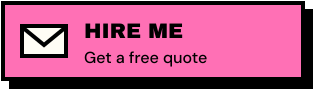</a>
  <a href="https://codenameberndev.vercel.app">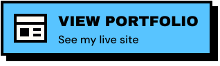</a>

 

<h3>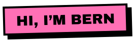</h3>

I'm a **BS Information Technology student and web developer** who builds portfolio websites and static and dynamic websites for people who want a clean online presence.

I use AI as a tool to work faster (**AI-assisted development, not ~~vibe coding~~**), and I understand and test every line I ship. I take on client work to support my family and my tuition, so I treat every project like it matters.

 

<h3></h3>

  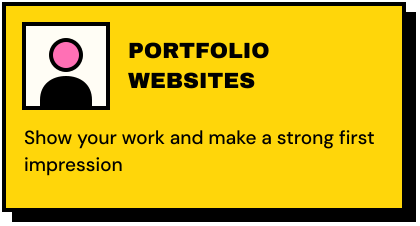
  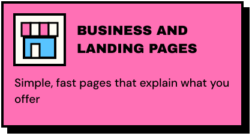
  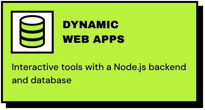
  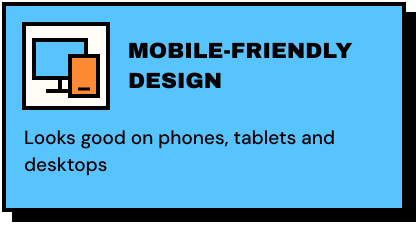

 

<h3>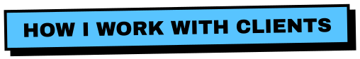</h3>

  <picture>
    <source media="(max-width: 600px)" srcset="https://raw.githubusercontent.com/codenamebern-design/codenamebern-design/HEAD/assets/process-mobile.svg" />
    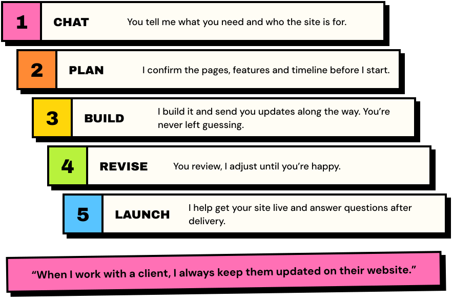
  </picture>

 

<h3>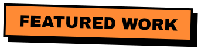</h3>

  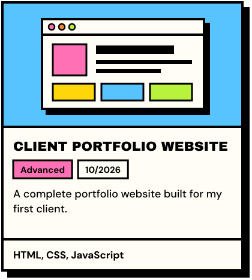
  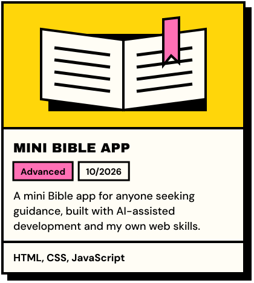
  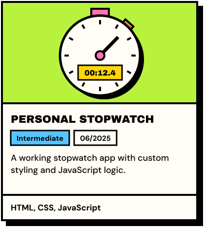
  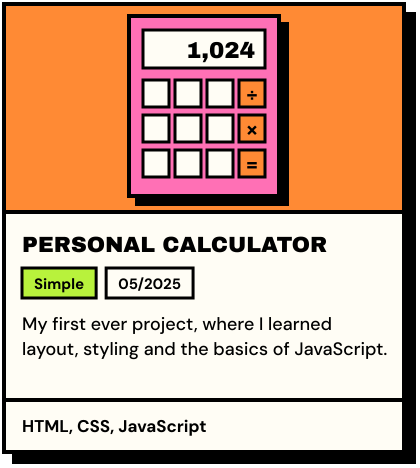

  <a href="https://github.com/codenamebern-design?tab=repositories">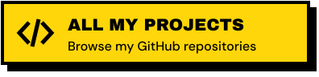</a>

 

<h3>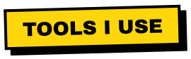</h3>

  <picture>
    <source media="(max-width: 600px)" srcset="https://raw.githubusercontent.com/codenamebern-design/codenamebern-design/HEAD/assets/tools-mobile.svg" />
    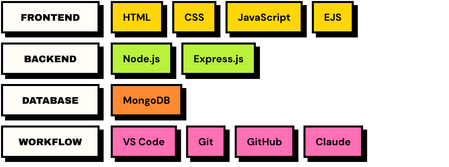
  </picture>

 

<h3>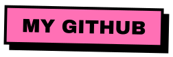</h3>

  <picture>
    <source media="(prefers-color-scheme: dark)" srcset="https://raw.githubusercontent.com/codenamebern-design/codenamebern-design/output/github-snake-dark.svg" />
    
  </picture>

 

  <picture>
    <source media="(max-width: 600px)" srcset="https://raw.githubusercontent.com/codenamebern-design/codenamebern-design/HEAD/assets/contact-mobile.svg" />
    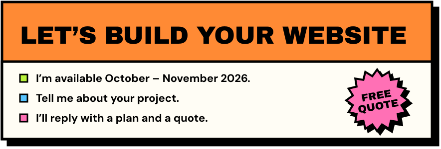
  </picture>

  <a href="mailto:codenamebern@gmail.com">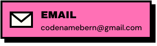</a>
  <a href="https://www.facebook.com/bern.lloyd.emperado.2024">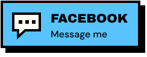</a>
  <a href="https://github.com/codenamebern-design">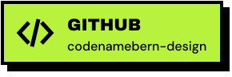</a>

